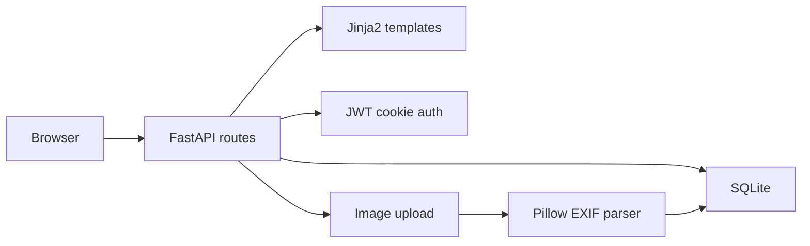

# AI-Generated Code Security Analysis

**Independent AppSec Project · In Progress**

Can an AI-generated application work correctly while retaining overlooked security flaws? This project audits a locally controlled, AI-generated photo portfolio app. The baseline application, initial code review, and developer-reported manual experiments are complete. Remediation is **planned, not implemented**.

## Baseline
Python · FastAPI · SQLite / SQLAlchemy · Jinja2 · Pillow / EXIF · JWT cookies · bcrypt · Docker · ExifTool (testing).

## Findings in current unpatched code

| ID | Issue | Evidence |
| --- | --- | --- |
| SEC-001 | Predictable JWT development key fallback | `auth.py:13` |
| SEC-002a | Raw EXIF metadata saved without sanitization | `routers/admin.py:37–54,145–154` |
| SEC-002b | Extension-based upload checks | `routers/admin.py:133–143` |
| SEC-003 | No explicit CSRF tokens on state-changing forms | Code review; exploit untested |
| SEC-004 | No explicit application upload-size cap | Code review; DoS untested |
| SEC-005 | Container lacks non-root `USER` | `Dockerfile` |

**Proof-of-concept status:** I tested EXIF metadata injection and uploading a non-image file renamed `.jpg`. The reviewed ZIP did not retain the injected database row or disguised file, so those PoCs are **author-reported, not independently reproduced from this snapshot**.

**Stored XSS clarification:** The backend persists untrusted EXIF strings. Current Jinja2 output auto-escapes HTML, so **browser-executed stored XSS has not been demonstrated**. The concern is unsafe metadata storage and possible second-order XSS in a future unsafe output sink.

Read the [full security assessment](SECURITY_AUDIT.md) for line references, evidence limits, and next steps.

## Planned security fixes (not yet applied)
- Apply `html.escape()` to EXIF values as an additional defense while retaining context-aware output escaping.
- Use `PIL.Image.verify()`, decoded image-format allowlisting and byte limits; reject invalid uploads with HTTP 415 and clean up files.
- Require secure JWT secrets from the environment.
- Add a non-root Docker `appuser`; evaluate CSRF controls.
- Rerun documented tests and attach before/after evidence.

## Safety and publication
The baseline is intentionally vulnerable: **run only in an isolated local environment**. Do not publish `portfolio.db` (contains an admin bcrypt hash), session data, secrets, or uploaded user content. This documentation does not claim a completed fix or production compromise.
